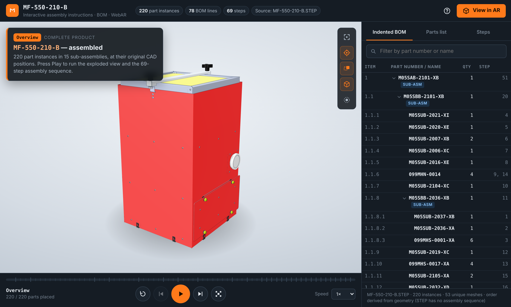
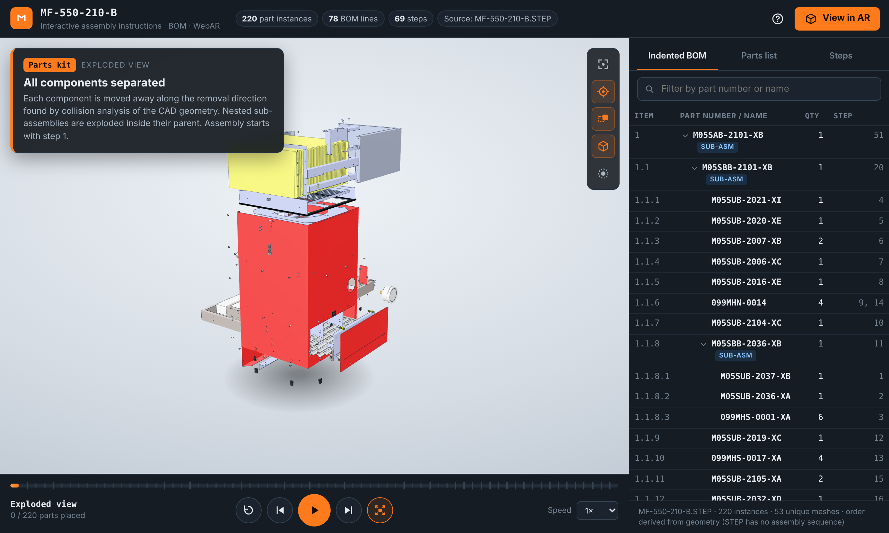
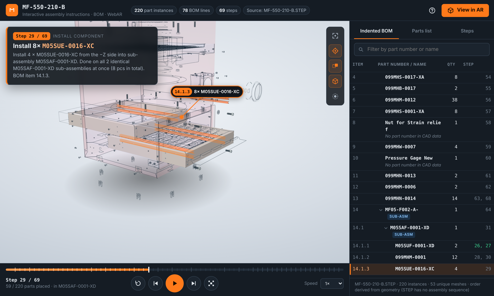
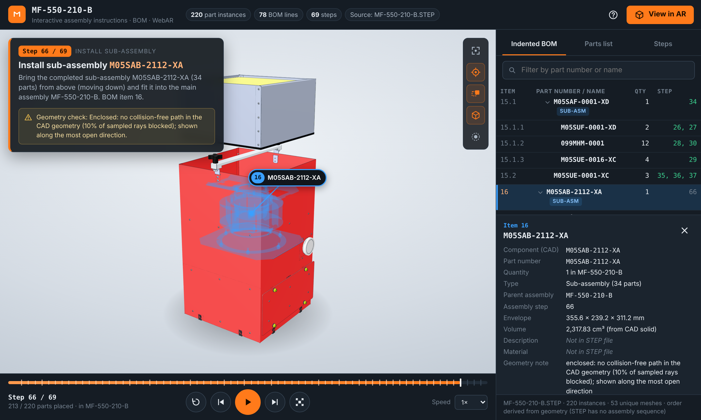
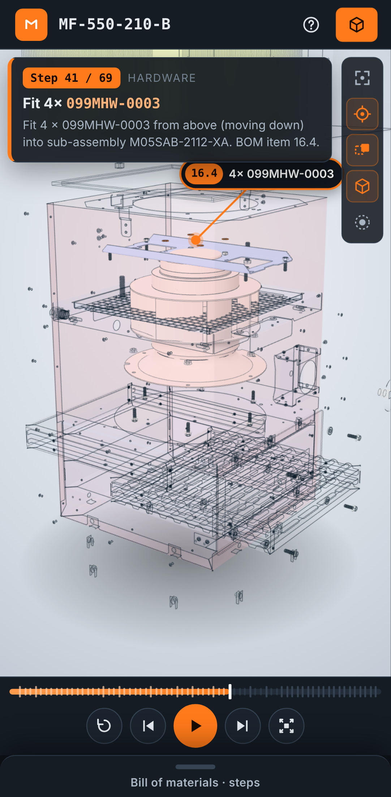

# MF-550-210-B — WebAR Assembly Instructions

Interactive, browser-based assembly instructions generated directly from the CAD model
`MF-550-210-B.STEP`: animated exploded view, step-by-step assembly sequence, an
indented Bill of Materials synchronised with the 3D view, and an augmented-reality
mode for phones and tablets.



| Exploded view | Sub-assembly step (context ghosted) |
|---|---|
|  |  |

| Selection, BOM data sheet, X-ray | Phone layout |
|---|---|
|  |  |

---

## 1. Quick start

Requirements: **Node.js ≥ 18** (only to serve the files; the app itself has no runtime npm dependencies).

```bash
npm start                # → http://localhost:8080
```

Any static web server works (`python3 -m http.server -d public 8080`, nginx, IIS, GitHub Pages, S3…).
Opening `public/index.html` from the file system does **not** work: browsers block module/GLB loading from `file://`.

Useful URLs:

| URL | Effect |
|---|---|
| `/` | Assembled overview |
| `/?autoplay` | Starts the full program automatically (kiosk / training station) |
| `/#step=29` | Deep link to assembly step 29 (the URL updates while you navigate, so steps can be shared) |

Keyboard: `Space` play/pause · `←/→` previous/next step · `E` exploded view · `R` restart · `F` frame · `G` ghost not-yet-installed parts · `I` isolate selection · `Esc` clear selection.

---

## 2. What was found in the STEP file

| Item | Finding |
|---|---|
| File | `MF-550-210-B.STEP`, 73.6 MB, ISO 10303-21, **AP214** (`AUTOMOTIVE_DESIGN`), written by **SolidWorks 2022** |
| Units | inch (`CONVERSION_BASED_UNIT` 0.0254 m) → converted to metres |
| Product structure | **One `PRODUCT`, no `NEXT_ASSEMBLY_USAGE_OCCURRENCE`.** The assembly was exported as a single multi-body part ("Save Assembly as Part") containing **220 `MANIFOLD_SOLID_BREP` bodies** |
| Hierarchy | **Recoverable.** SolidWorks wrote the full component path into every body name, e.g. `M05SAB-2101-XB-1/M05SBB-0022-XC-1/099MHM-0012-3-solid1` = sub-assembly › sub-sub-assembly › part file + instance number + body number. Parsing these names rebuilds **16 assemblies** (5 main sub-assemblies, up to 4 levels deep) and **220 part instances** |
| Part numbers / quantities | Component file names (`M05SUB-2021-XI`, `099MHM-0012`, …) → 53 distinct components; quantities counted per parent and per product |
| Names without part number | 17 components have descriptive or vendor file names (`Pressure Gage New`, `Strain relief`, `Mesh Media Camfil MF-550`, `SCHAUFEL0.STP`, …). They are listed with their CAD name and the flag *“No part number in CAD data”* |
| Purchased unit | `Drawing_DKHR250-2SW.078.5DF_IE_N63-25041+Q51-22503.STP` (fan with motor, impeller blades…) is an imported vendor assembly. It is handled as **one purchased unit**: installed in one step, not exploded internally; its internal parts are still listed in the BOM |
| Colours | Face colours (`STYLED_ITEM`, 16 colours) — kept per face |
| **Not in the STEP** | Descriptions, materials, revisions, mates/constraints, **assembly order**. Shown as *“Not in STEP file”* — never invented. Real values can be merged from an ERP/PDM export (§ 4.4) |

---

## 3. Project structure

```
mf550-webar/
├── public/                         ← deployable web app (static files only)
│   ├── index.html
│   ├── css/app.css
│   ├── js/
│   │   ├── main.js                 app bootstrap & wiring (single data flow)
│   │   ├── data/AssemblyModel.js   assembly.json access: tree, BOM, steps
│   │   ├── scene/Viewer.js         renderer, camera, orbit controls, lighting, floor
│   │   ├── scene/ModelLoader.js    GLB (meshopt) loading, node ↔ BOM linking
│   │   ├── scene/Explode.js        exploded-view offsets (CAD position + f · vector)
│   │   ├── scene/Sequencer.js      timeline / state machine (play, pause, steps)
│   │   ├── scene/Appearance.js     active / ghost / selected materials, X-ray, CAD edges
│   │   ├── scene/Picker.js         3D picking (mouse, touch, XR rays)
│   │   ├── scene/Callout.js        technical-drawing balloons (item numbers)
│   │   ├── ui/BomPanel.js          indented BOM, parts list, step list, search
│   │   ├── ui/Details.js           component data sheet
│   │   ├── ui/text.js              instruction text generated from data
│   │   └── ar/
│   │       ├── ARSupport.js        AR capability detection
│   │       ├── WebXRSession.js     markerless WebXR AR (hit-test, gestures, DOM overlay)
│   │       └── QuickLook.js        iOS AR Quick Look (animated USDZ)
│   ├── vendor/three/               three.js r187 (MIT), minified, only the modules used
│   └── assets/model/
│       ├── MF-550-210-B.glb               0.87 MB, meshopt-compressed, 1 node per component
│       ├── assembly.json                  hierarchy, BOM, explode vectors, 69-step sequence
│       └── MF-550-210-B-assembly.usdz     11.7 MB, animated, for AR Quick Look
├── pipeline/
│   ├── convert_step.py             STEP → GLB + assembly.json (OpenCascade)
│   ├── disassembly.py              ray-cast disassembly analysis (explode + sequence)
│   ├── config.json                 tessellation / instancing / explode / sequence settings
│   └── requirements.txt
├── tools/
│   ├── serve.mjs                   zero-dependency static server (HTTP/HTTPS, correct MIME types)
│   └── build-usdz.cjs              pre-builds the animated USDZ (headless browser)
├── tests/smoke.cjs                 end-to-end checks incl. emulated WebXR session
└── docs/screenshots/
```

---

## 4. STEP → web conversion pipeline

Browsers cannot read STEP. The pipeline converts it **once, offline** with OpenCascade
Technology (the CAD kernel behind FreeCAD/CadQuery) and the app only loads the results.

### 4.1 Install & run

```bash
python3 -m pip install -r pipeline/requirements.txt     # cadquery-ocp, numpy, trimesh, embreex, rtree
npm install                                              # dev tools: gltfpack, playwright, iwer (tests)

python3 pipeline/convert_step.py path/to/MF-550-210-B.STEP --out public/assets/model
npm run build:usdz       # optional: refresh the iOS USDZ after a conversion
```

The full conversion of this file takes ≈ 35 s on 2 CPU cores. Without `gltfpack` on the PATH the
script uses `npx gltfpack`; with `--no-compress` it writes an uncompressed GLB (4.2 MB).

### 4.2 What the pipeline does

1. **Read** the STEP into an XCAF document (names + colours). Two input styles are supported:
   *true assemblies* (product structure, instance transforms) and *multi-body parts with
   SolidWorks component paths in body names* (this file). Both end up in the same component tree.
2. **Geometric properties** per solid with OCCT: exact B-rep bounding box, volume, centroid,
   principal moments/axes of inertia.
3. **Instancing.** Bodies with the same component name are compared via a rigid (Kabsch) fit of
   their B-rep vertices; if every vertex matches within 0.001 mm they share one mesh and get a
   node transform. Result: 220 instances → **53 unique meshes** (167 instances reuse geometry).
   Mirrored or different geometry is never merged.
4. **Tessellation** (BRepMesh, chord deviation 0.02–0.6 mm relative to part size, 20° angular),
   per-face colours kept as materials. 141 k unique / 469 k rendered triangles.
5. **Disassembly analysis** (§ 5) → exploded-view vectors and the assembly sequence.
6. **Export**: glTF 2.0 binary, metres, Y-up, one named node per component (`extras.nid` links
   the node to `assembly.json`), then **gltfpack** (`-kn -ke -cc`, 16-bit positions ≈ 0.01 mm)
   for meshopt compression: **73.6 MB STEP → 0.87 MB GLB**.

Geometry fidelity is verified in `npm test`: every part's bounding box in the browser matches the
exact B-rep box from OpenCascade within a 0.75 mm tolerance — measured maximum **0.25 mm**
(tessellation chord error + quantisation).

### 4.3 Configuration (`pipeline/config.json`)

| Key | Meaning |
|---|---|
| `tessellation.*` | Mesh density (relative chord deviation, min/max mm, angular deviation) |
| `instancing.maxVertexDeviationMm` | Tolerance for sharing geometry between instances |
| `treatAsUnit.patterns` | Regex for sub-assemblies handled as purchased units (default: imported `*.STP/STEP` files) |
| `partNumberPattern` | Which CAD names count as part numbers |
| `explode.*` | Distances (fraction of parent size, fastener pull-out factor, stacking gap) |
| `disassembly.*` | Rays per item, contact tolerance, allowed blocked fraction, hardware size threshold |

### 4.4 Adding real BOM data (descriptions, materials, revisions)

The STEP file carries none of these. Export them from SolidWorks/PDM/ERP as CSV and merge by part number:

```bash
python3 pipeline/convert_step.py MF-550-210-B.STEP --bom-csv bom_export.csv
```

```csv
PartNumber,Description,Material,Revision
M05SUB-2021-XI,Housing wrap,Steel sheet 16 ga,C
```

Only columns that exist are used; unmatched components keep the *“Not in STEP file”* placeholder.

---

## 5. How the exploded view and the assembly sequence are derived

A STEP file contains **no assembly order and no mates**. Instead of animating parts along arbitrary
directions, the pipeline performs an *assembly-by-disassembly* analysis on the real geometry, for
every assembly level of the hierarchy:

1. Each child (part or rigid sub-assembly) is represented by its tessellated CAD geometry in CAD position.
2. **Structural parts.** Rays are cast from ~300 points sampled on each part along ±X, ±Y, ±Z
   (Embree ray engine, 167 k rays in ~3 s). Hits on other parts that are still present block that
   direction. A greedy disassembly repeatedly removes the parts that have a collision-free direction
   (preferring outward and upward), smallest first.
3. **Hardware** (axisymmetric parts detected from their inertia tensor, and parts < 6 % of the parent size)
   is pulled out along its own axis, head first, and is installed right after the last part it touches
   (detected from hole-edge geometry inside its envelope).
4. **Assembly order = reverse of the removal order.** Sub-assemblies are built bottom-up before they
   are installed into their parent; identical sub-assemblies (e.g. 2 × `M05SAF-0001-XD`) are built in
   shared steps.
5. **Exploded distances** clear the parent envelope along the removal direction and are stacked so
   parts leaving in the same direction keep their order. In the assembled state every component is at
   its **exact CAD transform** (`npm test` checks a maximum offset of 0).

Result for MF-550-210-B: **69 steps** (11 base placements, 25 component installs, 27 hardware steps,
6 sub-assembly installs).

**Transparency.** 25 steps carry a *Geometry check* note shown in the step card:
- *Hardware with no free axial path* — rivets, clinch studs/nuts or threaded parts modelled with
  interference (deformed or pressed in, so physically they have no free path). Shown head-first.
- *Enclosed* — the filter modules and the fan cannot leave the housing without passing through a
  panel that belongs to the housing sub-assembly (in reality a door/panel is opened). Shown along the
  most open direction.

The order is a geometrically valid proposal, **not** the released work instruction. To impose your
own sequence, reorder `steps` in `assembly.json` (each step lists its `nodes`) — the app needs no code change.

---

## 6. Application architecture

```
             assembly.json ─┐                          ┌─► ExplodeController (positions)
 GLB ─► ModelLoader ─► nodes ├─► Sequencer.pos ─────────┼─► Appearance (active / ghost / X-ray)
                            │   (single source of truth)├─► BomPanel (current row), step card,
                            │                           │   progress bar, callout, AR overlay
 user click / BOM row ──────┴─► Selection ──────────────┴─► Appearance, BomPanel, Details, callout
```

* **One source of truth.** The exploded factor of every component is a pure function of the
  sequencer position: steps < k assembled, step k animating, steps > k exploded. BOM highlight, 3D
  highlight, step card and AR overlay are all derived from the same position, so they cannot drift
  apart (verified for all 69 steps in `npm test`).
* **Timeline**: assembled overview → exploded parts kit (reverse-order cascade) → steps 1…69 →
  completed product. Play / pause (freezes mid-animation) / resume / restart / previous / next /
  click on the progress bar or the step list / speed 0.5–3×.
* **Context ghosting**: while a sub-assembly is being built, everything outside it is translucent;
  parts not yet installed are ghosted; the current step is orange; an **X-ray overlay** keeps active
  or selected parts visible through enclosing panels.
* **Performance**: shared geometry, shared material variants (state changes swap references only),
  meshopt + quantised GLB, edges built once per unique mesh, no post-processing (WebXR compatible).

---

## 7. Augmented reality

| Device / browser | AR method | Experience |
|---|---|---|
| **Android** phone/tablet with ARCore (Google Play Services for AR), **Chrome** ≥ 83 (other Chromium browsers with WebXR AR, e.g. Samsung Internet) | **WebXR** `immersive-ar` + `hit-test` + `dom-overlay` | Full: floor/table detection, tap to place at **real size 1:1**, 1-finger rotate, 2-finger move & pinch scale (5–300 %, quick 1:1/1:2/1:4 button), play/pause/steps/explode in AR, tap a part → BOM data in the overlay, re-place button |
| **Meta Quest** Browser (passthrough) | WebXR `immersive-ar` + `hit-test` | Place with the controller trigger; same sequencer. (No DOM overlay on Quest: use the controller to place, the step runs from the page) |
| **iPhone / iPad**, Safari (iOS 12+) | **AR Quick Look** (ARKit) | Apple does not support WebXR in Safari. The app opens a USDZ that contains the **same exploded-view → 69-step assembly animation** (≈ 97 s, loops); ARKit handles placement, scaling and rotation. The interactive BOM stays in the web page |
| Desktop browsers | — | Full 3D viewer. The AR dialog lists the checks and offers the link and the animated USDZ download |

Tracking method: markerless plane detection (ARCore/ARKit). Marker-based libraries (AR.js, MindAR)
were not used: they need a printed target, give less stable scale and add dependencies; WebXR gives
true metric scale, which matters for a 0.43 × 0.70 × 0.44 m product.

### Testing AR on a phone

WebXR and Quick Look require a **secure context** (HTTPS, or `localhost`):

* **Android, quickest:** USB debugging → `adb reverse tcp:8080 tcp:8080` → open `http://localhost:8080` in Chrome on the phone.
* **Local HTTPS:** create a trusted certificate, e.g. `mkcert -install && mkcert -cert-file certs/cert.pem -key-file certs/key.pem 192.168.1.20 localhost` (install the mkcert root CA on the phone), then `npm run start:https` and open `https://192.168.1.20:8080`.
* **Deploy:** copy `public/` to any HTTPS static host (GitHub Pages, Netlify, S3/CloudFront, IIS…).
  Make sure `.usdz` is served as `model/vnd.usdz+zip` and `.glb` as `model/gltf-binary` (`tools/serve.mjs` does this).

### Browser compatibility (3D viewer)

Needs ES modules, import maps and WebGL 2: current Chrome/Edge, Firefox ≥ 108, Safari ≥ 16.4
(desktop & iOS). Tested headless in Chromium (desktop 1366 × 820 and Pixel 7 emulation). Responsive layout:
sidebar on desktop, bottom sheet on phones.

---

## 8. Tests

```bash
npm install && npx playwright install chromium   # first time
npm test
```

Checks: app loads without errors · geometry of all 220 parts within tolerance of the B-rep (max 0.25 mm measured) ·
positions, highlight, BOM row and step card synchronised for all 69 steps · exact CAD positions after
the last step · autoplay completes · **WebXR session** under the Immersive Web Emulation Runtime
(floor hit-test, placement, steps and scaling in AR, clean exit).

---

## 9. Limitations

* The STEP file has no assembly order, mates, descriptions, materials or revisions (see § 2, § 4.4, § 5).
* Suppressed or hidden components that SolidWorks did not export are not in the file and therefore not in the BOM.
* The purchased fan unit is shown as one component; its internal geometry is the vendor's simplified model.
* Real hardware devices were not available in this environment: the AR flow was verified with WebXR
  emulation (IWER) and the USDZ was generated and inspected, but not opened on a physical iPhone/Android device. Test on target hardware before release.
* Quick Look shows the animation only; per-step navigation and BOM interaction are web-only on iOS.

## 10. Third-party components

three.js r187 (MIT, vendored) · OpenCascade Technology via cadquery-ocp (LGPL-2.1 w/ exception / Apache-2.0) ·
gltfpack / meshoptimizer (MIT) · trimesh (MIT) · Embree (Apache-2.0) · Playwright, IWER (dev/test only).
