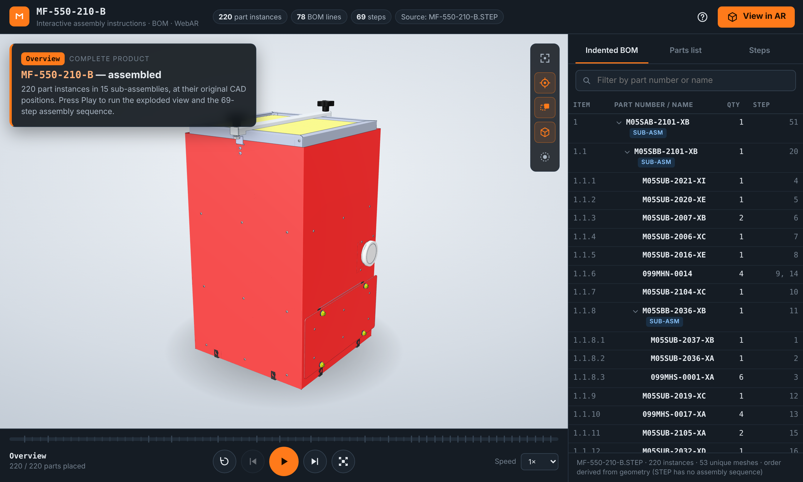
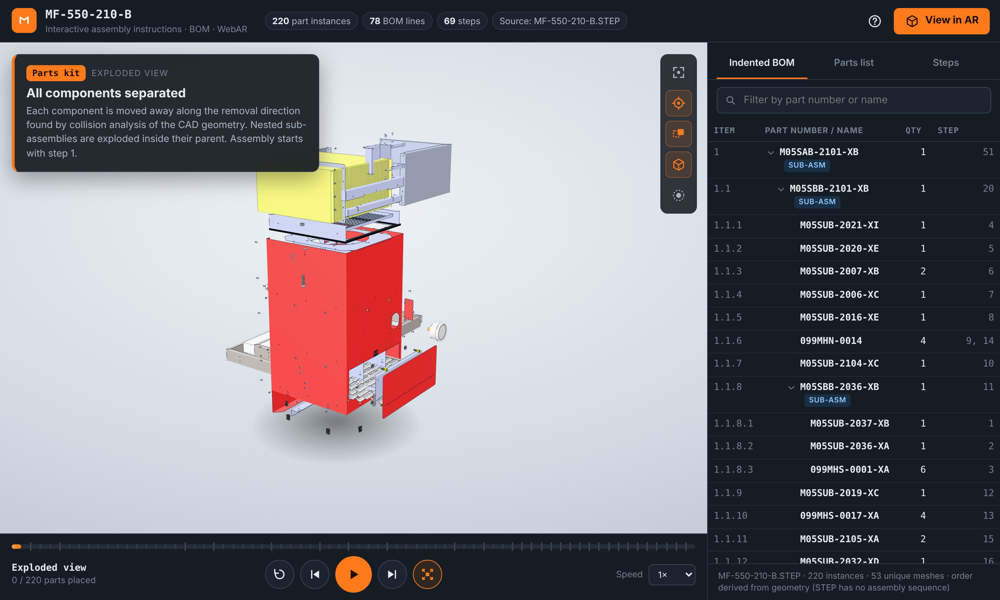
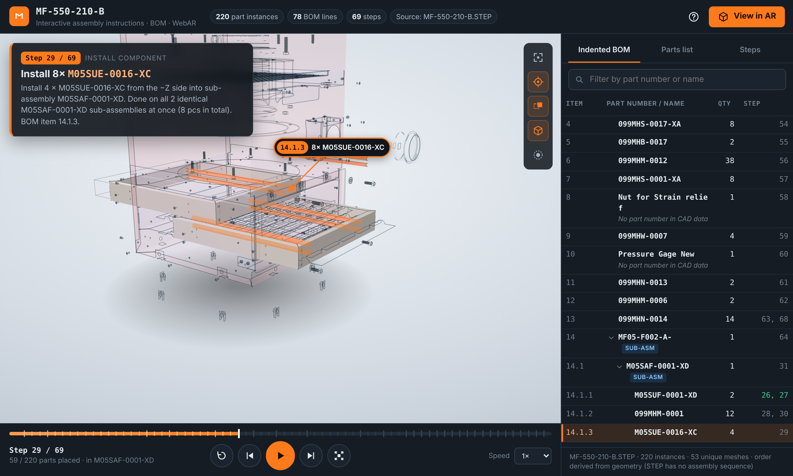
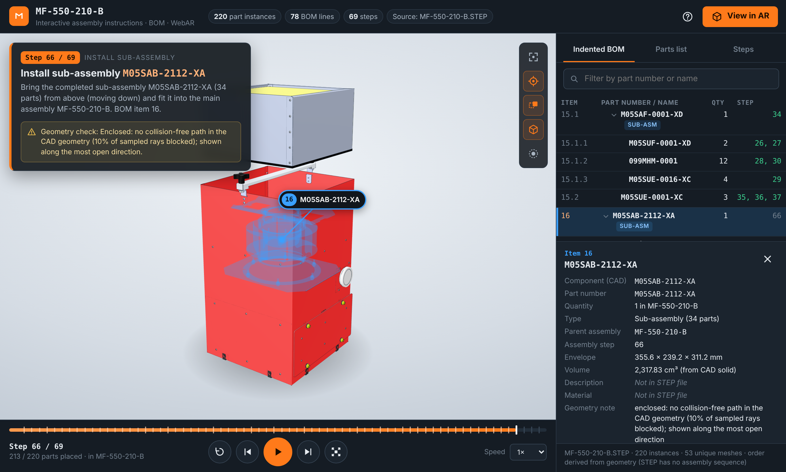
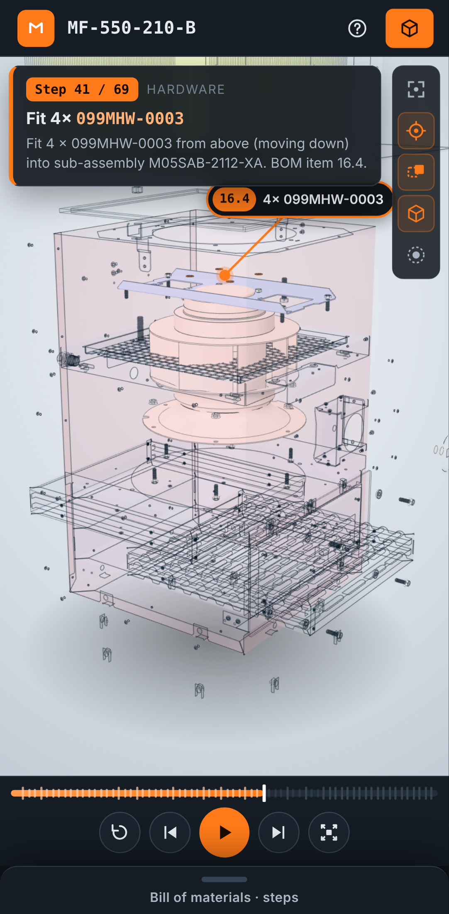

# Mist-Fit 550 — WebAR Assembly Instructions

**Live app:** https://opinofaeroex.github.io/mf550-assembly/ · **Version 1.4** (natural neural-voice narration, AEROEX Technologies branding — see [§ 0](#0-whats-new-in-version-14)) · by **AEROEX Technologies**

Interactive, browser-based assembly instructions for the **Mist-Fit 550**, generated directly from its
CAD model (internal identifier `MF-550-210-B`): animated exploded view, an automatic camera that
moves close to the components of every step, step-by-step assembly sequence explained by voice, a
Bill of Materials synchronised with the 3D view, hands-free navigation with a right-hand thumbs up /
down, and an augmented-reality mode for phones and tablets.



| Exploded view | Sub-assembly step (context ghosted) |
|---|---|
|  |  |

| Selection, BOM data sheet, X-ray | Phone layout |
|---|---|
|  |  |

*Screenshots show version 1.0; v1.4 adds the AEROEX symbol in the header and the natural voice; v1.1 replaces the Play button with **PREVIOUS STEP / NEXT STEP**, adds the narration bar to the step card and uses a 3× exploded distance; v1.2 adds component names, the **Gestures** panel and the status chip; v1.3 shows the name **Mist-Fit 550**, a BOM without item numbers, the AR status dot and the close-up camera.*

---

## 0. What's new in version 1.4

| Feature | Behaviour |
|---|---|
| **Natural voice** | Every position (overview, parts kit, 69 steps, completion) is narrated by a **neural text-to-speech voice**: *Heart*, US English, from the open **Kokoro-82M** model. The 72 recordings are pre-generated MP3 files (7.7 min, 2.8 MB) served by GitHub Pages, so there are no API keys and no speech service at runtime. |
| **Spoken script** | The voice no longer reads the card's title *and* instruction (which say the same thing twice). It says the operation once, phrased to be heard (`public/js/audio/spokenScript.js`), e.g. *"Step 35. Fit the first of three perforated filter baffles to the filter frame half sub-assembly."* Component, quantity, target, direction and repeat notes come from the same step facts as the card (`ui/text.js stepFacts`), and the tests check that both match for all 69 steps. Nothing is invented: no torques, tools or safety statements. |
| **Pronunciation** | A separate pronunciation layer keeps the on-screen names untouched. Spoken aliases (`SPOKEN_ALIASES`, e.g. *Mist-Fit 550* → "Mist-Fit five fifty") and an IPA lexicon for the natural voice (`tools/narration/lexicon.json`: *Mist-Fit*, *bellmouth*, *enclosure*). |
| **Synchronisation** | Unchanged contract: the narration starts when you enter a step, stops at once when you leave it, plays once per step (the looping animation never restarts it) and never advances the step. Buttons, keys, AR overlay and gestures share the same navigation path. Rapid navigation can never play an outdated recording: each start carries a token, and late downloads are aborted or dropped. |
| **Controls** | Play / Pause / **Resume from the same point**, Replay, Mute (`M`, remembered). Under ⚙: voice (natural voice, or one of the browser's voices; remembered — a browser voice picked before v1.4 is not carried over, so returning visitors hear the natural voice), **speed** 0.8–1.25× (pitch kept, applied live) and **volume** (remembered; on iPhone/iPad the hardware buttons control it). |
| **Performance** | One audio element for the session. The current recording (~40 kB) is fetched into memory first, then the **next step's recording is preloaded** in the background at low priority. At most 10 recordings are kept in memory. The manifest is fetched once. |
| **Fallback** | If a recording is missing, the network fails, the browser can't play MP3 or a recording is out of date, the browser's own voice (Web Speech API) reads the same script and a one-line notice explains why. Without either voice, a notice says so and the written instructions remain. Nothing in the 3D view, AR, gestures or navigation depends on the voice. |
| **AEROEX branding** | The supplied AEROEX symbol now appears in the header (before **Mist-Fit 550**, which stays the product name), on the loading screen, and as the favicon / home-screen icon. The original files are kept unchanged in `public/assets/brand/original/`. |

### Text-to-speech provider evaluation

The narration needs about 6,000 characters (72 positions), so any provider's free tier would cover it. The deciding factors were quality, pronunciation control, licensing and the static-hosting constraint.

| | Google Cloud TTS (Chirp 3: HD) | Azure AI Speech (neural / HD) | ElevenLabs | **Kokoro-82M (chosen)** |
|---|---|---|---|---|
| Naturalness | Very high, conversational | High | Very high | High (top-ranked open model) |
| Pronunciation control | IPA / X-SAMPA, speed, pause markup | Full SSML + lexicons | Pronunciation dictionaries | Inline IPA per word (misaki G2P) |
| Cost for this script | Free tier (1 M chars / month); **billing account required** | Free tier (0.5 M chars / month) | Commercial use from **$5 / month** | Free |
| Commercial licence | Yes | Yes | Paid plans only | **Apache-2.0** |
| Account / credentials | Google Cloud project + key | Azure subscription + key | Account + key | **None** |
| GitHub Pages | Pre-generated audio | Pre-generated audio | Pre-generated audio | Pre-generated audio |

**Decision:** Kokoro-82M, voice *Heart* (`af_heart`), US English. Samples of four Kokoro voices were compared, and *Heart* was chosen for its warm, clear, professional delivery. It needs no account, no billing and no secret, can be regenerated by anyone with the repository, and its licence allows commercial use. Google's Chirp 3: HD voices are the closest match to a navigation-assistant voice and would be the upgrade path. `generate.py` writes the same manifest format, so the player would not change, but it needs a Google Cloud project with billing and a key kept out of the repository (for example a GitHub Actions secret).

**Hosting: pre-generated audio (option A), not a backend (option B).** The text changes only when the assembly data changes, so recording once is cheaper, faster, more consistent and more reliable than synthesising on demand. No credentials exist anywhere in the app or the repository, and nothing runs besides GitHub Pages. A backend would add hosting, cost, latency and a key to protect, for no benefit.

### Natural voice — how it is produced

```
assembly.json ─► spokenScript.js ─► export-script.mjs ─► generate.py ──────────────────────► public/assets/narration/
 (step facts)     (natural phrasing)   (72 positions)     misaki G2P + lexicon.json (IPA)       manifest.json
                                                          Kokoro-82M · voice af_heart · 0.92×    en-US-heart/*.mp3
                                                          pauses: 0.30 s after "Step N.", 0.45 s between sentences
                                                          loudness −17 LUFS, look-ahead limiter −1.5 dBFS
                                                          MP3 mono 24 kHz 48 kbit/s
```

* **Files:** `public/assets/narration/en-US-heart/step-03-fit-the-pan-head-machine-screws.mp3` and so on, plus
  `overview.mp3`, `parts-kit.mp3` and `complete.mp3`. `manifest.json` lists for every key the file, the exact
  spoken text, the duration, the size and a content hash.
* **Text check:** the app plays a recording only if its text in the manifest equals the script it wants to
  speak. If the assembly data changes and the audio is not regenerated, those steps fall back to the
  browser voice instead of saying something else.
* **Quality review:** `npm run narration:verify` transcribes every file with an independent speech recogniser
  (NVIDIA Parakeet-TDT 0.6B v2) and measures loudness, peaks and pace → [`docs/narration-review.md`](docs/narration-review.md).
  Current result:
  * **Word accuracy:** 96.6 %. The remaining differences are spelling only ("sub-assembly" / "subassembly",
    "in closure" for *enclosure*), plus "bellmouth support" heard as "bell mouse support": the *th* runs into
    the *s*, as in natural speech.
  * **Loudness:** all files at −17.5 ± 0.2 LUFS.
  * **Pace:** median 165 words/min including pauses.

  This review found two real issues, both fixed in `lexicon.json`:
  * the product name, which was heard as "Misfit 550";
  * "bellmouth", which was read like "Plymouth".

  A human listening pass on the target devices is still recommended.

### Updating the narration

1. Change the data or the wording (`public/js/audio/spokenScript.js`), or add a pronunciation to
   `tools/narration/lexicon.json`.
2. Re-record. Only changed positions are regenerated; files that are no longer used are deleted:

   ```bash
   pip install -r tools/narration/requirements.txt && python3 -m spacy download en_core_web_sm   # once
   npm run narration                          # ≈ 6 min on 2 CPU cores for all 72; seconds for a few
   npm run narration -- --only step-08 --force
   npm run narration:verify -- --asr <folder of sherpa-onnx-nemo-parakeet-tdt-0.6b-v2-int8>        # optional review
   ```

   The Kokoro model files (~350 MB) are downloaded once from the kokoro-onnx GitHub release and checked by
   SHA-256. Requirements: Python 3.10+, Node 18+ (to export the script with the app's own modules), and
   ffmpeg.
3. Run `npm test` and commit `public/assets/narration/`.

**Costs and external services:** none at runtime and none for generation (local, open model). GitHub Pages
serves the files with the rest of the site (about 40 kB per step). No API key or credential exists in the
code, the repository, the browser or the network requests.

### AEROEX branding assets

| File | Use |
|---|---|
| `public/assets/brand/original/images.png` | Supplied AEROEX symbol, white on black (447 × 447), unchanged |
| `public/assets/brand/original/Logo.jpg` | Supplied AEROEX symbol, black on white (200 × 200), unchanged; kept for light backgrounds |
| `public/assets/brand/aeroex-symbol-white.png` | Web copy of `images.png`: same pixels, black background made transparent, trimmed to the symbol (309 × 246, proportions kept). Used in the header (28 px high, 24 px on phones) and on the loading screen. |
| `favicon-32.png`, `favicon.ico`, `apple-touch-icon.png` (180), `icon-192.png` | Downscaled from `images.png` (the symbol on its black square), for browser tabs and home screens |

The horizontal AEROEX Technologies logo (with the wordmark) was not part of the supplied files. The
interface therefore uses the symbol only, without imitating the wordmark. To add it later, place the file in
`public/assets/brand/` and use it in the header's `.brand` block.

---

## 0.1 What's new in version 1.3

| Feature | Behaviour |
|---|---|
| **AR straight from Chrome** | The **View in AR** button checks what this browser and device can really do and shows it with a status dot: 🟢 *supported* (starts WebXR AR immediately — Chrome on an ARCore Android phone), 🟡 *needs permission* (camera blocked for the site, or the page is embedded without AR permission — the dialog says what to allow and offers *Try AR again*), ⚪ *unavailable* (the button reads **AR options** and the dialog says why: desktop computer, no ARCore, not HTTPS…), 🔵 *active* while an AR session or the camera overlay runs. AR is never shown as available when the session cannot start. |
| **Camera overlay (not AR)** | Fallback for browsers without immersive AR (desktop Chrome with a webcam, phones without ARCore): the camera picture is shown behind the 3D model. It is labelled *“Camera overlay — not AR”*: there is no tracking and the model is not anchored to the room. Navigation, narration, BOM and the automatic camera keep working. |
| **One camera at a time** | WebXR AR, the camera overlay and gesture tracking never open the camera together: gesture tracking pauses when AR or the overlay starts and resumes when they end (if gesture control is still on). |
| **Automatic close-up camera** | On every step the 3D camera moves smoothly to the components that step installs, chosen from the geometry (see below). Orbit, pan or zoom at any time: the automatic camera then pauses (*“Auto camera paused — Refocus”*) until the next step or until you press **Refocus** / <kbd>C</kbd>. The target button in the view tools turns it on / off (remembered). |
| **Mist-Fit 550** | The interface shows the product name **Mist-Fit 550** (tab title, header, overview, details, AR files). The STEP source file name is no longer displayed anywhere; internal identifiers (`MF-550-210-B`, part numbers, file names) are unchanged. |
| **Simpler BOM** | The hierarchical ITEM numbers (1.1.1, 1.1.2 …) are gone from the BOM, parts list, step card, details and 3D balloons. Components are identified by their names (part numbers below them); the tree indentation still shows the structure. Internally every row keeps its item key, parent link and part number, so selection, highlighting, steps and camera targets are unchanged. |
| **Smoother animation** | Fix: animation phases now start from where the previous phase left the parts. Each loop cycle moves the step's parts out *and* back in, and PREVIOUS STEP removes a part without first snapping it back. |

### How the automatic camera works

`public/js/scene/CameraController.js` — one plan per step, computed from data, never hand-placed:

1. **Components** — the nodes listed in `assembly.json` for the step (`steps[k].nodes`) and their parts' meshes.
   Nothing is guessed: no step without components exists, and none needs a manual target.
2. **Focus region** — the components at their final (CAD) position plus the last part of their approach path
   (≤ 22 cm or 1.2 × their size) so the looping motion is visible; never smaller than a 7 cm sphere, so small
   hardware keeps its context. Several components → one region that contains them all (zooms out as needed).
3. **Viewpoint** — 60 candidate directions are scored by *sight lines* from the components' surface to the
   camera, tested against the triangles of all parts that are drawn solid at that step (ghosted parts do not
   block), by a view *across* the install direction, by a natural elevation (≈ 30° above) and by the
   smallest turn from the current view. So the camera moves round to reveal hidden mounting points and looks
   from below for parts fitted from below.
4. **Distance** — fits the region into the part of the view that the step card does not cover.
5. **Motion** — the camera orbits to the new view (0.9–1.6 s, ease-in-out; instant with *reduced motion*)
   and then follows the model while it settles; it never changes the step.

Plans are evaluated a few milliseconds per frame in the background (current step first, then its
neighbours, then all), so the 3D view never stutters. Tunables: `CONFIG.camera` in `public/js/config.js`.
The review of all 69 steps is in [`docs/camera-review.md`](docs/camera-review.md): every step has a target
from its own components; **6 steps (10, 15, 29, 54, 64, 65)** fit parts *inside* the housing, so no outside
view has a clear line of sight — they are framed and the x-ray highlight shows the parts; they are listed
there for manual review.

### Browser and device requirements (v1.3)

| Device / browser | 3D viewer + automatic camera | AR | Camera overlay | Gestures |
|---|---|---|---|---|
| Android phone / tablet with ARCore, **Chrome** 81+ | ✓ | **WebXR** (floor placement, 1:1) | ✓ | ✓ (paused during AR) |
| Android without ARCore / other browsers | ✓ | ✗ — reason shown | ✓ | ✓ |
| **Desktop Chrome / Edge** (Windows, macOS, Linux) | ✓ | ✗ — computers have no AR tracking | ✓ with a webcam | ✓ |
| iPhone / iPad, Safari | ✓ | **AR Quick Look** (USDZ) | ✓ | ✓ |
| iPhone / iPad, Chrome | ✓ | Quick Look when iOS allows it, otherwise reason shown | ✓ | ✓ |

All camera features need HTTPS (the GitHub Pages site is HTTPS).

---

## 0.2 What's new in version 1.2

| Feature | Behaviour |
|---|---|
| **New STEP file** | The app is converted from `MF-550-210-B_MIST_FIT_550_FINAL_NAMED.STEP`. Its geometry is identical to the earlier export, its 220 solids now carry descriptive names (46 distinct, e.g. *Blind Rivet*, *Unit Body*, *Impeller Drive Motor*). The names appear in the BOM, step card, balloons, details and narration; part numbers stay in their own column. See [§ 2.1](#21-the-new-step-file-v12). |
| **Short instructions** | Every step has a short title and a one-line instruction, generated from the data (`public/js/ui/text.js`), e.g. *Step 18 – Install the Access Door: "Fit the access door to the door frame."* The components line shows quantity, name, part number and BOM item. The voice says exactly the title and the instruction — no part numbers read aloud, no torques, tools or safety statements (not in the data). |
| **Looping step animation** | While you stay on a step, its motion repeats (hold → parts move back out → assemble again). The loop never changes the step and never restarts the narration; the narration plays once when you enter a step (or when you press Replay). |
| **Right-hand gesture navigation** | Open **Gestures** (top bar) → **Enable gesture control**. Show a **right-hand thumbs up 👍** for NEXT STEP or a **thumbs down 👎** for PREVIOUS STEP. Hold it briefly (≈ 0.3 s); each gesture acts once; return your hand to neutral (open hand, or hand out of view) before the next one. The left hand is ignored. Gestures, buttons, keys and the AR overlay call the same `App.next()` / `App.prev()`. |
| **Gesture feedback** | Gesture panel with camera / hand / gesture status, a hold meter, an optional mirrored camera preview with the tracked hand, a status chip on the 3D view, and a short toast *👍 NEXT STEP ACTIVATED* / *👎 PREVIOUS STEP ACTIVATED* that does not block the model. |

### Gesture recognition — how it works

* **Technology: MediaPipe Hand Landmarker** (`@mediapipe/tasks-vision` 1.2.3, Apache-2.0) — 21 hand
  landmarks and a left/right classification per hand, in the browser (WebAssembly + WebGL), 15 analysed
  frames per second. The library and the 7.5 MB model are downloaded **only when you enable gesture
  control** (from jsDelivr and Google's model storage). The video never leaves the device.
  *Evaluated alternatives:* a YOLO detector would need a custom-trained thumbs-up/down model and has no
  handedness output; OpenCV adds nothing MediaPipe does not already do (camera, preprocessing) — neither
  is used.
* **Classification** (`public/js/gesture/GestureClassifier.js`) uses several landmarks, never one:
  ≥ 3 of the 4 fingers curled (3D world landmarks), thumb extended and straight, thumb within 65° of
  vertical, and the thumb tip the highest (up) / lowest (down) point of the hand. Thresholds were tuned
  on real Hand Landmarker output (`tests/fixtures/hand-landmarks.json`).
* **Right hand only, mirroring-safe:** the raw camera frames are analysed (the preview is mirrored with
  CSS only), and MediaPipe ≥ 1.2 labels the *subject's* hands for non-mirrored frames — verified with
  MediaPipe's own `right_hands.jpg` / `thumb_up.jpg` test images. `inputMirrored` in `config.js` and the
  panel option *Swap left / right* cover cameras that deliver mirrored frames.
* **One action per gesture** (`public/js/gesture/GestureTrigger.js`): the same gesture for ≥ 5 frames and
  ≥ 300 ms → one NEXT / PREVIOUS → locked until the hand has been neutral for 4 frames and ≥ 1 s has
  passed. Holding the thumb up never advances twice.
* **Configuration:** `CONFIG.gestures` in `public/js/config.js` (URLs, frame rate, confidence, trigger and
  classifier thresholds).
* **Camera lifecycle** (`public/js/gesture/CameraManager.js`, `GestureController.js`): the camera starts
  only after you press *Enable gesture control* (browser permission prompt), and is released when you
  disable it, when the page goes to the background, and **during a WebXR AR session** (ARCore needs the
  camera; tracking resumes automatically afterwards). On iPhone/iPad, AR Quick Look is a separate app:
  tracking pauses while it is open.
* **Fallbacks:** permission denied, no camera, camera busy, no HTTPS, library/model not loadable,
  unsupported browser → a clear message in the panel; NEXT / PREVIOUS, narration and animation keep working.

| Gesture control | Works with |
|---|---|
| Desktop | Chrome / Edge 90+, Firefox 115+, Safari 16.4+ with a webcam (HTTPS or localhost) |
| Android | Chrome 90+ (front camera). Not while a WebXR AR session runs (camera in use by ARCore) |
| iPhone / iPad | Safari 16.4+ (front camera). Paused while AR Quick Look is open |
| Performance | GPU (WebGL) inference, CPU fallback; ≈ 15 analysed frames/s; the 3D view keeps its own frame rate |

**Self-hosting MediaPipe** (offline / intranet): copy `vision_bundle.mjs` and the `wasm/` folder of
`@mediapipe/tasks-vision@1.2.3` and `hand_landmarker.task` into `public/vendor/mediapipe/` and set
`visionBundle`, `wasmBase` and `model` in `CONFIG.gestures` to `./vendor/mediapipe/…`.

---

## 0.3 What's new in version 1.1

| Feature | Behaviour |
|---|---|
| **Manual step navigation** | The app never advances on its own. **NEXT STEP** / **PREVIOUS STEP** (transport bar, AR overlay, `→` / `←`) move along the track *Overview → Parts kit → Step 1 … Step 69*. PREVIOUS is disabled on the overview, NEXT on the final step. You can navigate while an animation or a narration is running: the running animation is replaced (never queued) and the narration is cancelled. The former Play/autoplay mode and `?autoplay` were removed. |
| **Voice narration** | Every position has a spoken explanation (`public/js/audio/narrationScript.js`): operation, components and quantities, install direction, BOM item / part number / quantity, the step's purpose in the assembly structure (which sub-assembly it builds and in which step that sub-assembly is installed) and the documented geometry notes. It starts automatically when you enter a step; changing step stops it immediately. **Play / Pause / Resume** (one button, `Space`), **Replay** (`P`, replays narration *and* the step animation), **Mute / Unmute** (`M`, remembered), voice and speed selector (⚙). The end of the narration never changes the step. *(Since v1.2 the voice says only the short step title and instruction.)* |
| **3× exploded view** | Every displacement vector — hardware, parts and sub-assemblies — is multiplied by `explodeScale = 3` (`public/js/config.js`). Directions, removal order and assembly relationships are unchanged; the assembled state is still the exact CAD position. The camera frames the larger exploded view beside the step card. |
| **iOS AR Quick Look** | Choose **this step** (loops the current step's motion, consistent with manual navigation) or the **full sequence**; both use the 3× vectors and are generated on the device. |

### Voice technology — what it is and what it is not

*(v1.1–v1.3. Since v1.4 the narration is a pre-recorded natural voice ([§ 0](#0-whats-new-in-version-14)); the Web
Speech API described here is the fallback, and the alternative voice under ⚙.)*

The narration uses the **Web Speech API** (`speechSynthesis`) of the browser: no API key, no
server, no audio files, works offline with installed voices. Voice quality therefore depends on the browser:

| Browser | Voices used (best one is chosen automatically) |
|---|---|
| **Microsoft Edge** (Windows, macOS, Android) | Microsoft online **"Natural" voices** (e.g. *Microsoft Jenny Online (Natural)*). These are neural TTS voices run by Microsoft and supplied through the browser; they are labelled "Natural (neural)" in the voice panel. |
| Google Chrome | Google network voices (*Google US English*) or the operating-system voices. |
| Safari (macOS / iOS) | Apple system voices; downloadable *Enhanced / Premium* voices are preferred when installed (Settings › Accessibility › Spoken Content). |
| Firefox | Operating-system voices. |

Only voices the browser itself marks "Natural"/"Neural" are described as neural; all others are shown as
"standard voice supplied by your browser or operating system". This app does **not** call a cloud neural
TTS service. A cloud service (Azure/Google/ElevenLabs) or pre-generated neural audio would need API
credentials or a recording workflow plus binary audio files in the repository; the narration scripts in
`narrationScript.js` are ready to be fed to such a service if required later.

Behaviour details: speech is spoken sentence by sentence (avoids the Chrome cut-off on long texts and
gives reliable pause/resume — resume restarts the interrupted sentence); a generation token discards
events of cancelled utterances, so narrations can never overlap; browsers block speech until the first
click/tap on the page — the bar then shows *"Tap Play to hear the instructions"* and the narration starts
on the next interaction. Without the Web Speech API the controls are disabled and the written
instructions in the step card remain the reference.

### State management

`public/js/state/AppState.js` holds the UI state (`position`, `animating`, `narration`, `muted`, `voice`,
`selection`). The Sequencer (position/animation), the Narrator (voice) and the selection publish into it;
the navigation buttons, narration controls and AR overlay render from it, so every control shows the
same truth. All listeners are bound once at start-up.

---

## 1. Quick start

Requirements: **Node.js ≥ 18** (only to serve the files; the app itself has no runtime npm dependencies).

```bash
npm start                # → http://localhost:8080
```

Any static web server works (`python3 -m http.server -d public 8080`, nginx, IIS, GitHub Pages, S3…).
Opening `public/index.html` from the file system does **not** work: browsers block module/GLB loading from `file://`.

Useful URLs:

| URL | Effect |
|---|---|
| `/` | Assembled overview |
| `/#step=29` | Deep link to assembly step 29 (the URL updates while you navigate, so steps can be shared) |

Keyboard: `→` / `←` (or `PageDown` / `PageUp`) next / previous step · `Space` play / pause / resume narration · `M` mute · `P` replay · `E` exploded view · `R` back to overview · `F` frame · `G` ghost not-yet-installed parts · `I` isolate selection · `Esc` clear selection.

---

## 2. What was found in the STEP file

### 2.1 The new STEP file (v1.2)

| Check | Result |
|---|---|
| File | `MF-550-210-B_MIST_FIT_550_FINAL_NAMED.STEP`, 73.55 MB, AP214, SolidWorks 2022 (same header as the earlier export) |
| Compared with `MF-550-210-B.STEP` | **Same model.** 769,206 entities in both, all identical — geometry, topology, colours, placements — except the names of the 220 `MANIFOLD_SOLID_BREP` solids |
| Names | Descriptive component names instead of SolidWorks paths: 46 distinct names for 53 part numbers (each part number maps to exactly one name; e.g. all `099MHM-0001` → *Blind Rivet*, `SCHAUFEL0…7.STP` → *Impeller Blade*) |
| Hierarchy / part numbers | **Not in the new file** (it is still one multi-body part, and the component paths were replaced by the names). They are taken from the earlier export through `pipeline/structure-map.json`, which `pipeline/structure_map.py` only writes after proving that both files are the same model |
| Sub-assembly names | Not in either file. Sub-assemblies are labelled after their largest part (*Access Door sub-assembly*, *Unit Body assembly* …) and marked as derived in the BOM details |
| Result | Same GLB (byte-identical, 0.87 MB), same 69-step sequence and exploded-view vectors; `assembly.json` gains a `label` on every node, BOM row and step, and `meta.structureSource` records the provenance. No geometry was added, removed or moved |

### 2.2 Original analysis (v1.0)

| Item | Finding |
|---|---|
| File | `MF-550-210-B.STEP`, 73.6 MB, ISO 10303-21, **AP214** (`AUTOMOTIVE_DESIGN`), written by **SolidWorks 2022** |
| Units | inch (`CONVERSION_BASED_UNIT` 0.0254 m) → converted to metres |
| Product structure | **One `PRODUCT`, no `NEXT_ASSEMBLY_USAGE_OCCURRENCE`.** The assembly was exported as a single multi-body part ("Save Assembly as Part") containing **220 `MANIFOLD_SOLID_BREP` bodies** |
| Hierarchy | **Recoverable.** SolidWorks wrote the full component path into every body name, e.g. `M05SAB-2101-XB-1/M05SBB-0022-XC-1/099MHM-0012-3-solid1` = sub-assembly › sub-sub-assembly › part file + instance number + body number. Parsing these names rebuilds **16 assemblies** (5 main sub-assemblies, up to 4 levels deep) and **220 part instances** |
| Part numbers / quantities | Component file names (`M05SUB-2021-XI`, `099MHM-0012`, …) → 53 distinct components; quantities counted per parent and per product |
| Names without part number | 17 components have descriptive or vendor file names (`Pressure Gage New`, `Strain relief`, `Mesh Media Camfil MF-550`, `SCHAUFEL0.STP`, …). They are listed with their CAD name and the flag *“No part number in CAD data”* |
| Purchased unit | `Drawing_DKHR250-2SW.078.5DF_IE_N63-25041+Q51-22503.STP` (fan with motor, impeller blades…) is an imported vendor assembly. It is handled as **one purchased unit**: installed in one step, not exploded internally; its internal parts are still listed in the BOM |
| Colours | Face colours (`STYLED_ITEM`, 16 colours) — kept per face |
| **Not in the STEP** | Descriptions, materials, revisions, mates/constraints, **assembly order**. Shown as *“Not in STEP file”* — never invented. Real values can be merged from an ERP/PDM export (§ 4.4) |

---

## 3. Project structure

```
mf550-webar/
├── public/                         ← deployable web app (static files only)
│   ├── index.html
│   ├── css/app.css
│   ├── js/
│   │   ├── main.js                 app bootstrap & wiring (single data flow)
│   │   ├── config.js               explodeScale (3), narration settings, asset paths        (v1.1)
│   │   ├── state/AppState.js       observable UI state store                                 (v1.1)
│   │   ├── audio/Narrator.js       narration: natural voice first, browser voice as fallback  (v1.4)
│   │   ├── audio/RecordedVoice.js  plays the pre-recorded MP3s: preload, cache, stale guard   (v1.4)
│   │   ├── audio/BrowserVoice.js   Web Speech API engine (fallback / chosen browser voice)    (v1.4)
│   │   ├── audio/spokenScript.js   natural spoken script + spoken-only aliases               (v1.4)
│   │   ├── audio/narrationScript.js script + recording keys of every position                (v1.1)
│   │   ├── data/AssemblyModel.js   assembly.json access: tree, BOM, steps
│   │   ├── scene/Viewer.js         renderer, camera, orbit controls, lighting, floor
│   │   ├── scene/ModelLoader.js    GLB (meshopt) loading, node ↔ BOM linking
│   │   ├── scene/Explode.js        exploded-view offsets (CAD position + f · explodeScale · vector)
│   │   ├── scene/Sequencer.js      step state machine (manual NEXT / PREVIOUS, animations)
│   │   ├── scene/Appearance.js     active / ghost / selected materials, X-ray, CAD edges
│   │   ├── scene/Picker.js         3D picking (mouse, touch, XR rays)
│   │   ├── scene/Callout.js        technical-drawing balloons (component names)
│   │   ├── scene/CameraController.js automatic close-up camera for every step                  (v1.3)
│   │   ├── ui/BomPanel.js          indented BOM, parts list, step list, search
│   │   ├── ui/NarrationControls.js play/pause/resume, replay, mute, voice settings           (v1.1)
│   │   ├── ui/Details.js           component data sheet
│   │   ├── ui/text.js              short step titles / instructions (card, step list, AR, voice) (v1.2)
│   │   ├── ui/GesturePanel.js      Gesture Control panel, status chip, preview, feedback toast   (v1.2)
│   │   ├── gesture/
│   │   │   ├── CameraManager.js    camera on request only; released for AR / background         (v1.2)
│   │   │   ├── HandTracker.js      MediaPipe Hand Landmarker (lazy-loaded), handedness mapping   (v1.2)
│   │   │   ├── GestureClassifier.js thumbs up / down / neutral from the 21 landmarks             (v1.2)
│   │   │   ├── GestureTrigger.js   stabilisation, one action per gesture, cooldown, neutral      (v1.2)
│   │   │   └── GestureController.js camera → tracker → right hand → classifier → trigger events  (v1.2)
│   │   └── ar/
│   │       ├── ARSupport.js        AR capability detection: supported / needs permission / unavailable (v1.3)
│   │       ├── CameraOverlay.js    camera picture behind the 3D view — fallback, not AR          (v1.3)
│   │       ├── WebXRSession.js     markerless WebXR AR (hit-test, gestures, DOM overlay)
│   │       └── QuickLook.js        iOS AR Quick Look (USDZ of the current step or full sequence)
│   ├── vendor/three/               three.js r187 (MIT), minified, only the modules used
│   ├── assets/narration/                                                                       (v1.4)
│   │   ├── manifest.json           voice, format, and per position: file, exact text, duration, hash
│   │   └── en-US-heart/*.mp3       72 recordings (overview, parts-kit, step-01 … step-69, complete)
│   ├── assets/brand/               AEROEX symbol (web copy), favicons; original/ = supplied files  (v1.4)
│   └── assets/model/
│       ├── MF-550-210-B.glb               0.87 MB, meshopt-compressed, 1 node per component
│       └── assembly.json                  hierarchy, BOM, explode vectors (1×, from the pipeline), 69-step sequence
├── pipeline/
│   ├── convert_step.py             STEP → GLB + assembly.json (OpenCascade)
│   ├── structure_map.py            proves two STEP exports are the same model; maps names ↔ paths (v1.2)
│   ├── structure-map.json          verified map for MF-550-210-B_MIST_FIT_550_FINAL_NAMED.STEP    (v1.2)
│   ├── disassembly.py              ray-cast disassembly analysis (explode + sequence)
│   ├── config.json                 tessellation / instancing / explode / sequence settings
│   └── requirements.txt
├── tools/
│   ├── serve.mjs                   zero-dependency static server (HTTP/HTTPS, correct MIME types)
│   ├── build-usdz.cjs              pre-builds the animated USDZ (headless browser)
│   └── narration/                                                                              (v1.4)
│       ├── export-script.mjs       spoken script of every position (uses the app's modules)
│       ├── generate.py             records the narration with Kokoro-82M → MP3 + manifest
│       ├── lexicon.json            pronunciation overrides (IPA) for the natural voice
│       ├── verify.py               speech-recognition, loudness and pace review
│       └── requirements.txt
├── tests/smoke.cjs                 end-to-end checks incl. emulated WebXR session and gestures
├── tests/fixtures/hand-landmarks.json  real MediaPipe landmarks of public test images (v1.2)
├── docs/camera-review.md          camera targets of all 69 steps (generated)                  (v1.3)
├── docs/narration-review.md       transcription / loudness / pace review of the recordings    (v1.4)
└── docs/screenshots/
```

---

## 4. STEP → web conversion pipeline

Browsers cannot read STEP. The pipeline converts it **once, offline** with OpenCascade
Technology (the CAD kernel behind FreeCAD/CadQuery) and the app only loads the results.

### 4.1 Install & run

```bash
python3 -m pip install -r pipeline/requirements.txt     # cadquery-ocp, numpy, trimesh, embreex, rtree
npm install                                              # dev tools: gltfpack, playwright, iwer (tests)

# v1.2 — the named STEP file + the verified structure map (hierarchy and part numbers):
python3 pipeline/convert_step.py path/to/MF-550-210-B_MIST_FIT_550_FINAL_NAMED.STEP \
        --structure-map pipeline/structure-map.json --out public/assets/model
npm run build:usdz       # optional: pre-build public/assets/model/<product>-assembly.usdz (full sequence)

# only when a new pair of exports has to be mapped (refuses unless the geometry is identical):
python3 pipeline/structure_map.py NEW_NAMED.STEP --structure-from OLD_WITH_PATHS.STEP -o pipeline/structure-map.json
```

Without `--structure-map`, a STEP whose bodies have descriptive names is converted as a flat list of
named parts (no sub-assemblies, no part numbers); a STEP with a real product structure (NAUO) or with
SolidWorks component paths in the body names is converted with its hierarchy as before.

The full conversion of this file takes ≈ 35 s on 2 CPU cores. Without `gltfpack` on the PATH the
script uses `npx gltfpack`; with `--no-compress` it writes an uncompressed GLB (4.2 MB).

### 4.2 What the pipeline does

1. **Read** the STEP into an XCAF document (names + colours). Two input styles are supported:
   *true assemblies* (product structure, instance transforms) and *multi-body parts with
   SolidWorks component paths in body names* (this file). Both end up in the same component tree.
2. **Geometric properties** per solid with OCCT: exact B-rep bounding box, volume, centroid,
   principal moments/axes of inertia.
3. **Instancing.** Bodies with the same component name are compared via a rigid (Kabsch) fit of
   their B-rep vertices; if every vertex matches within 0.001 mm they share one mesh and get a
   node transform. Result: 220 instances → **53 unique meshes** (167 instances reuse geometry).
   Mirrored or different geometry is never merged.
4. **Tessellation** (BRepMesh, chord deviation 0.02–0.6 mm relative to part size, 20° angular),
   per-face colours kept as materials. 141 k unique / 469 k rendered triangles.
5. **Disassembly analysis** (§ 5) → exploded-view vectors and the assembly sequence.
6. **Export**: glTF 2.0 binary, metres, Y-up, one named node per component (`extras.nid` links
   the node to `assembly.json`), then **gltfpack** (`-kn -ke -cc`, 16-bit positions ≈ 0.01 mm)
   for meshopt compression: **73.6 MB STEP → 0.87 MB GLB**.

Geometry fidelity is verified in `npm test`: every part's bounding box in the browser matches the
exact B-rep box from OpenCascade within a 0.75 mm tolerance — measured maximum **0.25 mm**
(tessellation chord error + quantisation).

### 4.3 Configuration (`pipeline/config.json`)

| Key | Meaning |
|---|---|
| `tessellation.*` | Mesh density (relative chord deviation, min/max mm, angular deviation) |
| `instancing.maxVertexDeviationMm` | Tolerance for sharing geometry between instances |
| `treatAsUnit.patterns` | Regex for sub-assemblies handled as purchased units (default: imported `*.STP/STEP` files) |
| `partNumberPattern` | Which CAD names count as part numbers |
| `explode.*` | Distances (fraction of parent size, fastener pull-out factor, stacking gap) |
| `disassembly.*` | Rays per item, contact tolerance, allowed blocked fraction, hardware size threshold |

### 4.4 Adding real BOM data (descriptions, materials, revisions)

The STEP file carries none of these. Export them from SolidWorks/PDM/ERP as CSV and merge by part number:

```bash
python3 pipeline/convert_step.py MF-550-210-B.STEP --bom-csv bom_export.csv
```

```csv
PartNumber,Description,Material,Revision
M05SUB-2021-XI,Housing wrap,Steel sheet 16 ga,C
```

Only columns that exist are used; unmatched components keep the *“Not in STEP file”* placeholder.

---

## 5. How the exploded view and the assembly sequence are derived

A STEP file contains **no assembly order and no mates**. Instead of animating parts along arbitrary
directions, the pipeline performs an *assembly-by-disassembly* analysis on the real geometry, for
every assembly level of the hierarchy:

1. Each child (part or rigid sub-assembly) is represented by its tessellated CAD geometry in CAD position.
2. **Structural parts.** Rays are cast from ~300 points sampled on each part along ±X, ±Y, ±Z
   (Embree ray engine, 167 k rays in ~3 s). Hits on other parts that are still present block that
   direction. A greedy disassembly repeatedly removes the parts that have a collision-free direction
   (preferring outward and upward), smallest first.
3. **Hardware** (axisymmetric parts detected from their inertia tensor, and parts < 6 % of the parent size)
   is pulled out along its own axis, head first, and is installed right after the last part it touches
   (detected from hole-edge geometry inside its envelope).
4. **Assembly order = reverse of the removal order.** Sub-assemblies are built bottom-up before they
   are installed into their parent; identical sub-assemblies (e.g. 2 × `M05SAF-0001-XD`) are built in
   shared steps.
5. **Exploded distances** clear the parent envelope along the removal direction and are stacked so
   parts leaving in the same direction keep their order. In the assembled state every component is at
   its **exact CAD transform** (`npm test` checks a maximum offset of 0).
6. **Display scale (v1.1).** `assembly.json` keeps these vectors exactly as computed (1×). The viewer
   multiplies all of them by `CONFIG.explodeScale = 3` (`public/js/config.js`) — hardware, parts and
   sub-assemblies consistently — so directions and stacking order are preserved (all offsets scale
   together) and `f = 0` is still the CAD position. Change the one constant to tune the separation; the
   pipeline parameters in `pipeline/config.json` stay the collision-checked base. Hardware pull-out paths
   were collision-checked over the 1× distance; beyond it a fastener may visually pass near other parts.

Result for MF-550-210-B: **69 steps** (11 base placements, 25 component installs, 27 hardware steps,
6 sub-assembly installs).

**Transparency.** 25 steps carry a *Geometry check* note shown in the step card:
- *Hardware with no free axial path* — rivets, clinch studs/nuts or threaded parts modelled with
  interference (deformed or pressed in, so physically they have no free path). Shown head-first.
- *Enclosed* — the filter modules and the fan cannot leave the housing without passing through a
  panel that belongs to the housing sub-assembly (in reality a door/panel is opened). Shown along the
  most open direction.

The order is a geometrically valid proposal, **not** the released work instruction. To impose your
own sequence, reorder `steps` in `assembly.json` (each step lists its `nodes`) — the app needs no code change.

---

## 6. Application architecture

```
             assembly.json ─┐                          ┌─► ExplodeController (positions × explodeScale)
 GLB ─► ModelLoader ─► nodes ├─► Sequencer.pos ─────────┼─► Appearance (active / ghost / X-ray)
   NEXT / PREVIOUS ─────────►│   (single source of truth)├─► BomPanel (current row), step card,
                            │                           │   progress bar, callout, AR overlay
                            │                           └─► Narrator (stop previous → speak this step)
 user click / BOM row ──────┴─► Selection ──────────────────► Appearance, BomPanel, Details, callout
                 AppState ◄── position · animating · narration · muted · voice · selection ──► controls
```

* **One source of truth.** The exploded factor of every component is a pure function of the
  sequencer position: steps < k assembled, step k animating, steps > k exploded. BOM highlight, 3D
  highlight, step card and AR overlay are all derived from the same position, so they cannot drift
  apart (verified for all 69 steps in `npm test`).
* **Navigation track** (manual only): assembled overview → exploded parts kit (reverse-order cascade)
  → steps 1…69. NEXT / PREVIOUS, click on the progress bar or the step list, deep links, restart to
  the overview, exploded-view toggle, animation speed 0.5–3×. Nothing advances automatically.
* **Narration**: on every position change the previous narration is cancelled at once and the new
  script starts after a 150 ms debounce (rapid clicking never queues several narrations).
* **Context ghosting**: while a sub-assembly is being built, everything outside it is translucent;
  parts not yet installed are ghosted; the current step is orange; an **X-ray overlay** keeps active
  or selected parts visible through enclosing panels.
* **Performance**: shared geometry, shared material variants (state changes swap references only),
  meshopt + quantised GLB, edges built once per unique mesh, no post-processing (WebXR compatible).

---

## 7. Augmented reality

| Device / browser | AR method | Experience |
|---|---|---|
| **Android** phone/tablet with ARCore (Google Play Services for AR), **Chrome** ≥ 83 (other Chromium browsers with WebXR AR, e.g. Samsung Internet) | **WebXR** `immersive-ar` + `hit-test` + `dom-overlay` | Full: floor/table detection, tap to place at **real size 1:1**, 1-finger rotate, 2-finger move & pinch scale (5–300 %, quick 1:1/1:2/1:4 button), PREVIOUS / NEXT, narration play/pause and mute, explode toggle in AR, tap a part → BOM data in the overlay, re-place button. Gesture control pauses during the AR session (ARCore uses the camera) and resumes afterwards. With the 3× exploded view the parts kit spans several metres at 1:1 — use 1:2 or 1:4 indoors |
| **Meta Quest** Browser (passthrough) | WebXR `immersive-ar` + `hit-test` | Place with the controller trigger; same sequencer. (No DOM overlay on Quest: use the controller to place, the step runs from the page) |
| **iPhone / iPad**, Safari (iOS 12+) | **AR Quick Look** (ARKit) | Apple does not support WebXR in Safari. The app generates a USDZ on the device: **the current step** (its motion loops — use it to stay step-by-step) or the **full sequence** (≈ 97 s); ARKit handles placement, scaling and rotation. Narration, BOM and NEXT / PREVIOUS stay in the web page |
| Desktop browsers | — | Full 3D viewer with narration and automatic camera. **AR options** explains why there is no AR here and offers the **camera overlay (not AR)**, the link and USDZ downloads (current step / full sequence) |

Tracking method: markerless plane detection (ARCore/ARKit). Marker-based libraries (AR.js, MindAR)
were not used: they need a printed target, give less stable scale and add dependencies; WebXR gives
true metric scale, which matters for a 0.43 × 0.70 × 0.44 m product.

### Testing AR on a phone

WebXR and Quick Look require a **secure context** (HTTPS, or `localhost`):

* **Android, quickest:** USB debugging → `adb reverse tcp:8080 tcp:8080` → open `http://localhost:8080` in Chrome on the phone.
* **Local HTTPS:** create a trusted certificate, e.g. `mkcert -install && mkcert -cert-file certs/cert.pem -key-file certs/key.pem 192.168.1.20 localhost` (install the mkcert root CA on the phone), then `npm run start:https` and open `https://192.168.1.20:8080`.
* **Deploy:** copy `public/` to any HTTPS static host (GitHub Pages, Netlify, S3/CloudFront, IIS…).
  Make sure `.usdz` is served as `model/vnd.usdz+zip` and `.glb` as `model/gltf-binary` (`tools/serve.mjs` does this).

### Browser compatibility (3D viewer)

Needs ES modules, import maps and WebGL 2: current Chrome/Edge, Firefox ≥ 108, Safari ≥ 16.4
(desktop & iOS). Tested headless in Chromium (desktop 1366 × 820 and Pixel 7 emulation). Responsive layout:
sidebar on desktop, bottom sheet on phones.

---

## 8. Tests

```bash
npm install && npx playwright install chromium   # first time
npm test
```

The natural-voice recordings really play in headless Chromium (autoplay allowed by a launch flag); an
in-page spy on the audio element logs every play / pause / end with its recording key. Headless Chromium
has no speech voices, so the Web Speech API (fallback voice) is replaced by a deterministic in-page mock that
logs every speak / start / end / cancel (the app code is unchanged). 107 checks:

* **Viewer & data** — loads without errors; geometry of all 220 parts within tolerance of the B-rep (max 0.25 mm measured).
* **3× exploded view** — all 208 displacement vectors (hardware, parts, sub-assemblies) are exactly 3× the
  pipeline vectors with identical directions; measured scene offsets 3.000×; every component back at its
  exact CAD position after the final step; per-step USDZ export for Quick Look.
* **Synchronisation** — positions, highlight, BOM row, step card and spoken script (same component, quantity,
  target, direction, repeat note) for all 69 steps.
* **Manual navigation** — buttons and boundaries, disabled NEXT on the final step, **no automatic advance**
  after the animation and the narration have finished, natural-voice recording played once while the step
  loops, PREVIOUS during an animation, 6 rapid clicks (no recording ever starts for a step already left),
  a deliberately slow download for a step the user has left is never played.
* **Natural voice (v1.4)** — auto-start with the recording whose text equals the step's script, pause →
  resume from the same point, live speed 1.25× and volume 60 % (remembered, no restart), replay from 0,
  mute (stops at once, nothing on later steps), unmute, next-step preload without interruption, keyboard,
  natural voice selected by default with browser voices as alternatives, switching engines without overlap,
  a browser voice chosen in v1.1–v1.3 does not replace the natural voice, blocked-until-gesture, works without Web Speech, no audio and no speech → controls disabled.
* **Browser-voice fallback (v1.4)** — recordings unreachable → notice + Web Speech voice with the v1.1–v1.3
  behaviour (sentence pause/resume, replay, once per step, best voice); a single missing file (HTTP 404)
  falls back for that step only; no recordings and no speech → explicit message, navigation unaffected.
* **Recordings (v1.4)** — 72 entries for 72 positions with exactly the spoken script; every MP3 served as
  `audio/mpeg`, decodes with its listed duration; voice / loudness metadata; real playback of a recording
  runs in real time to its end.
* **WebXR AR** under the Immersive Web Emulation Runtime — hit-test, placement, NEXT + narration +
  scaling inside AR, clean exit; the gesture camera is released during the session and resumes after it.
* **New STEP integration (v1.2)** — source file and verified structure map, all 220 parts named, BOM shows
  names, instruction length limits, no part numbers read aloud (card text and, since v1.4, the spoken script:
  ≤ 30 words, no "(1/2)" marks).
* **Gestures (v1.2)** — classifier on **real MediaPipe landmarks** of public test images (thumbs up, thumbs
  down, tilted ±25°, left hand, fist, pointing, victory, open hand); trigger state machine (one frame never
  fires, a held gesture fires once, re-arm only after neutral); handedness mapping incl. mirrored input;
  end-to-end with Chromium's fake camera and a scripted tracker: right thumbs up / down navigate exactly
  once and stop the previous narration, left hand ignored, swap option, gesture during an animation,
  boundaries, button and gesture share `App.next()`, disable releases the camera, permission denied and no
  camera API leave the buttons working.
* **Automatic camera (v1.3)** — targets for all 69 steps from `steps[k].nodes`; ≥ 8 different viewpoints;
  first / single part / fasteners / large part / sub-assembly / motor area / spread rivets / final step: every
  component inside the uncovered view; smooth orbit (no jumps); a full loop cycle goes out and back, PREVIOUS
  without snap-back; orbit and zoom pause it, Refocus and the next step resume it; it follows button, key and
  gesture navigation; narration still once per step; on/off toggle remembered.
* **AR in Chrome (v1.3)** — capability states for Android Chrome with / without ARCore, camera denied,
  embedded page, desktop Chrome, iPhone, non-HTTPS; unsupported browser shows *AR options* with the reason;
  camera overlay with Chromium's fake camera (labelled *not AR*, gestures paused and resumed); WebXR session
  shows *AR active* and hands the camera to the device.
* **Branding & BOM (v1.3)** — *Mist-Fit 550* in title, header, overview and details; neither `MF-550-210-B` nor
  the STEP file name in any visible text, tooltip or dialog; no hierarchical item numbers in the BOM, parts
  list, step card, details or balloons; 78 internal item keys, parent links and part numbers intact; BOM row
  selection, highlight and *Go to step* work. v1.4: AEROEX symbol in the header (proportions identical to the
  artwork, before the product title) and on the loading screen; favicon / touch icons load; originals kept.

`ONLY=gestures npm test` runs one section (`viewer`, `navigation`, `integration`, `gestures`, `ar`, `camera`,
`archrome`, `branding`, `voice`).
The suite replaces MediaPipe with a scripted tracker (real landmark fixtures), so it runs without the
network. The real library and model are checked on the deployed site in a desktop browser: both load over
HTTPS, the Hand Landmarker labels MediaPipe's own `thumb_up.jpg` test image as a *Right* hand and the
classifier returns *thumbs up* for it. A live webcam test needs a person in front of the camera (§ 9).

---

## 9. Limitations

* The STEP file has no assembly order, mates, descriptions, materials or revisions (see § 2, § 4.4, § 5).
* Suppressed or hidden components that SolidWorks did not export are not in the file and therefore not in the BOM.
* The purchased fan unit is shown as one component; its internal geometry is the vendor's simplified model.
* Real hardware devices were not available in this environment: the AR flow was verified with WebXR
  emulation (IWER) and the USDZ was generated and inspected, but not opened on a physical iPhone/Android device. Test on target hardware before release.
* Quick Look shows the animation only; per-step navigation, narration and BOM interaction are web-only on iOS.
* Natural voice (v1.4): the recordings were checked objectively (speech recognition, loudness, pace — see
  `docs/narration-review.md`) and the voice was chosen from listening samples, but the full set was not
  listened to on the target devices in this environment — do a listening pass before release. Kokoro is a
  strong open model, but the best commercial voices (e.g. Google Chirp 3: HD) are still somewhat more
  expressive (§ 0). The browser voice used as fallback depends on the browser (see § 0.3). The first
  narration after opening the page waits for one click/tap (browser autoplay policy); iPhone/iPad ignore
  the in-app volume slider (hardware buttons), so it is hidden there.
* The README screenshots were taken with version 1.0.
* Only the AEROEX symbol was supplied; the horizontal AEROEX Technologies logo (wordmark) is not used (§ 0).
* Gestures: hand tracking was verified on still images and with an emulated camera, not with a person in
  front of a physical webcam in this environment — try it on the target device and adjust
  `CONFIG.gestures.trigger` / `classifier` if needed. Lighting, distance (≈ 0.4–1.5 m) and a visible wrist
  matter. The thumb direction is judged against the camera image, so keep the phone / webcam upright.
* Gesture control and WebXR AR do not run at the same time (one camera); Quick Look on iOS pauses it too.
* MediaPipe and its model are loaded from jsDelivr and Google's model storage on first use (≈ 4 MB library
  download compressed + 7.5 MB model, cached by the browser); self-host them for offline sites (§ 0.2).
* Sub-assembly names are derived from their largest part — the STEP files contain no sub-assembly names.
* WebXR AR was verified with the Immersive Web Emulation Runtime and the capability logic with simulated
  Android / desktop / iPhone browsers, not on a physical ARCore phone in this environment.
* Automatic camera: 6 steps fit parts inside the housing (no clear outside view — x-ray highlight; listed in
  `docs/camera-review.md`). Long approach paths start outside the close-up and enter the view.
* The camera overlay is not AR (no tracking); on a computer it uses the same webcam as gesture control, so
  gesture tracking pauses while it is open.

## Changelog

* **1.4** — Natural neural-voice narration: 72 pre-recorded MP3s (Kokoro-82M, voice *Heart*, en-US),
  natural spoken script built from the same step facts as the card, IPA pronunciation lexicon, loudness
  normalisation, recording pipeline + speech-recognition review (`tools/narration`); new narrator with recorded
  voice first and Web Speech fallback (missing file, network, unsupported audio, stale script), next-step
  preload, in-memory cache, stale-download guard, resume from the same point, live speed, volume control;
  the voice choice is stored under a new key, so a browser voice picked in v1.1–v1.3 does not hide the natural
  voice; AEROEX symbol in the header and loading screen, favicon and home-screen icons (originals kept); MP3 MIME
  type in `tools/serve.mjs`; on-screen notices no longer intercept taps on the step buttons; tests extended
  (natural voice, fallback, recordings, branding).
* **1.3** — Visible product name **Mist-Fit 550** (STEP file name no longer displayed); BOM, parts list,
  step card, details and balloons without hierarchical item numbers (internal keys unchanged); AR button with
  capability states (supported / needs permission / unavailable / active) and direct WebXR start in Chrome;
  camera-overlay fallback labelled *not AR*; one camera user at a time (AR, overlay, gestures); automatic
  close-up camera for every step (`CameraController`, sight-line tests on the CAD triangles, manual override,
  Refocus, on/off); fix: animation phases start from the current pose (loop out *and* in every cycle, no
  snap-back on PREVIOUS); `docs/camera-review.md`; tests extended.
* **1.2** — New authoritative STEP `MF-550-210-B_MIST_FIT_550_FINAL_NAMED.STEP` (same geometry, named
  components; hierarchy and part numbers kept through a verified structure map); component names in BOM,
  card, balloons and voice; short step titles and one-line instructions spoken exactly as displayed;
  continuous loop of the current step's animation; hands-free navigation with right-hand thumbs up / down
  (MediaPipe Hand Landmarker, stabilised one-shot trigger, camera lifecycle shared with AR); central
  `App.next()` / `App.prev()` for buttons, keys, AR overlay and gestures; tests extended (real-landmark
  fixtures, gesture end-to-end).
* **1.1** — Voice-guided narration for every step (Web Speech API; Play/Pause/Resume, Replay, Mute,
  voice & speed); strictly manual NEXT STEP / PREVIOUS STEP navigation (autoplay removed); exploded-view
  distance ×3 for hardware, parts and sub-assemblies; framing beside the step card; Quick Look of the
  current step; AppState store; tests extended to 38 checks. The pre-built full-sequence USDZ (1×) was
  removed — it is generated on the device, or rebuilt with `npm run build:usdz`.
* **1.0** — STEP → GLB pipeline with geometric disassembly analysis, interactive BOM, exploded view,
  69-step sequence, WebXR AR and AR Quick Look.

## 10. Third-party components

three.js r187 (MIT, vendored) · **Kokoro-82M** voice model (Apache-2.0; used offline to record the narration,
not shipped) · kokoro-onnx (MIT) · misaki G2P (Apache-2.0) · espeak-ng (GPL-3.0, only as misaki's fallback
phonemizer inside the offline recording tool; not distributed with the app) · NVIDIA Parakeet-TDT 0.6B v2 via
sherpa-onnx (CC-BY-4.0 / Apache-2.0; optional review tool only) · OpenCascade Technology via cadquery-ocp (LGPL-2.1 w/ exception / Apache-2.0) ·
gltfpack / meshoptimizer (MIT) · trimesh (MIT) · Embree (Apache-2.0) · MediaPipe Tasks Vision + Hand
Landmarker model (Apache-2.0, loaded at runtime when gesture control is enabled) · Playwright, IWER (dev/test only).
